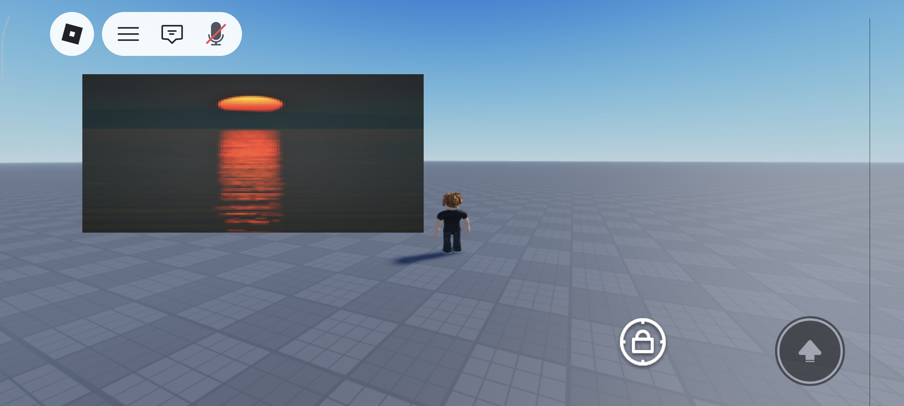

# Image-to-Roblox GUI renderer

Convert images into Roblox GUI pixel renderers.

# Output

The script can generate:

- `.rbxmx` - Roblox XML model, importable into Roblox Studio.
- `.lua` - Standalone Lua script that creates the GUI at runtime.

The generated .rbxmx file that can be imported into Roblox Studio.
For better performance, you can convert it using:

[Lune](https://github.com/lune-org/lune/)

This helps transform the output into .rbxm (binary file) for faster loading in Roblox Studio.

# Example of use
``` bash
python ImageToRBX.py image.png
```
# Change resolution:
```bash
python ImageToRBX.py image.png -w 128 -H 96
```
# Generate standalone Lua:
```bash
python ImageToRBX.py image.png --format lua
```
# Install dependencies
``` bash
pip install -r requirements.txt
```

# Output example


# Warning
> For educational purposes only
> do not use to circumvent the Terms of Service.

If you liked the project, please give it a star.
